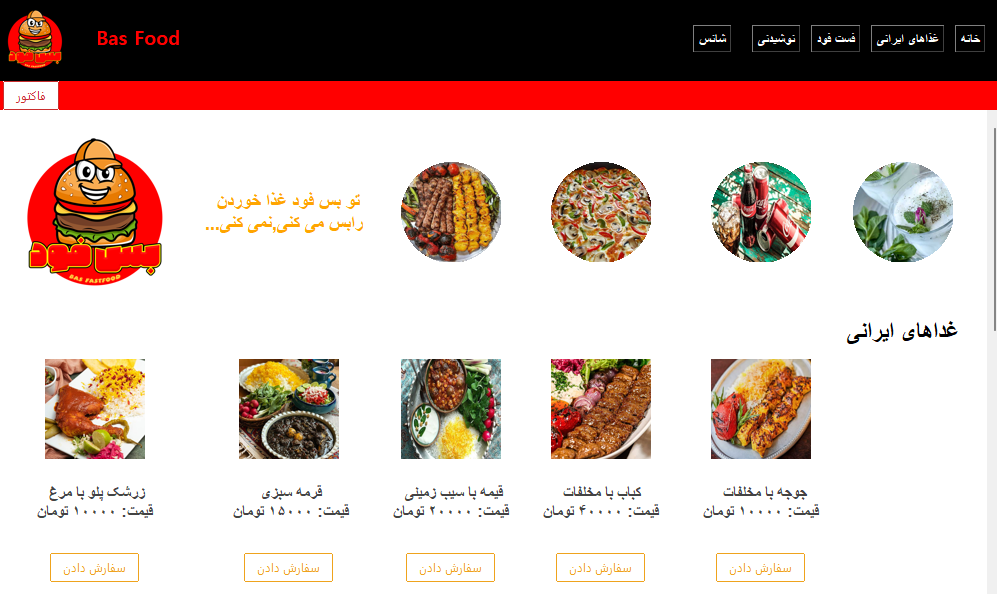
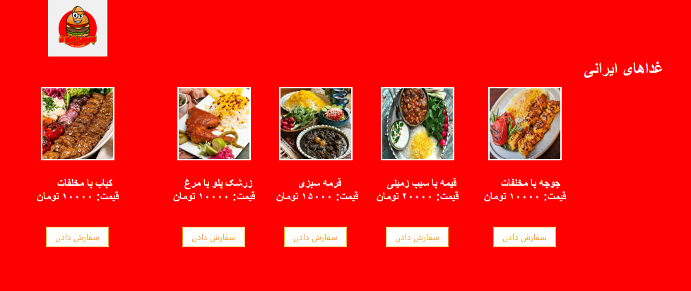
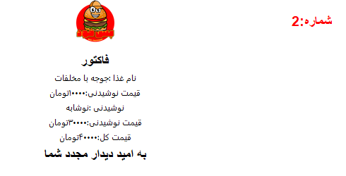

# Bas Food

**Bas Food** is a desktop restaurant ordering application built with Python, Tkinter, and ttkbootstrap. It allows users to browse food and drink menus, place orders, and review an invoice.

## Features

- Home page with navigation to the main sections.
- Separate menus for Iranian foods, fast food, and drinks.
- Menu items displayed with pictures, names, and prices.
- Order controls for menu items.
- Invoice section for reviewing the order and total price.
- Random luck feature in the invoice section that may grant a discount on the total amount.

## Screenshots

### Home page



### Iranian foods



### Invoice and luck feature



## Application sections

| Section | Description |
| --- | --- |
| Home | Main page and navigation to the menu sections. |
| Iranian Foods | Browse Iranian dishes and their prices. |
| Fast Food | Browse the available fast-food items. |
| Drinks | Browse the available drinks. |
| Invoice | Review ordered items and the total price. The random luck feature is also available here. |

For detailed instructions, see the [Application Guide](docs/application-guide.md).

## Project structure

```text
BASFOOD-with-TKinter/
├── B-Morvarid/                  # Font files used by the application
├── pic/                         # Application images and icon assets
├── docs/
│   ├── application-guide.md     # Detailed user guide
│   └── images/                  # Screenshots used in this documentation
│       ├── home-page.png
│       ├── iranian-foods.png
│       └── invoice-and-luck.png
├── app_resturant.py             # Main application window and interface
├── functions.py                 # Application functions
├── app_resturant.spec           # PyInstaller configuration
├── requirements.txt             # External Python dependencies
├── LICENSE                      # MIT License
└── README.md                    # Project overview and setup instructions
```

## Technologies

- **Python** — application programming language.
- **Tkinter** — desktop graphical user interface.
- **ttkbootstrap** — themed Tkinter widgets.
- **Pillow** — image loading and processing.

## Requirements

- Python 3
- `ttkbootstrap`
- `Pillow`

Tkinter is included with many standard Python installations. On some Linux distributions, it may need to be installed separately using the operating system's package manager.

## Installation

1. Clone the repository:

   ```bash
   git clone https://github.com/Mhsarabi/BASFOOD-with-TKinter.git
   ```

2. Open the project directory:

   ```bash
   cd BASFOOD-with-TKinter
   ```

3. Create a virtual environment (recommended):

   ```bash
   python -m venv env
   ```

4. Activate the virtual environment.

   **Windows:**

   ```bash
   env\Scripts\activate
   ```

   **macOS / Linux:**

   ```bash
   source env/bin/activate
   ```

5. Install the dependencies:

   ```bash
   pip install -r requirements.txt
   ```

## Run the application

Run the main file from the project root:

```bash
python app_resturant.py
```

Run the application from the project root so that relative paths to the `pic/` directory can be resolved.

## License

This project is licensed under the MIT License. See [LICENSE](LICENSE) for the full license text.
